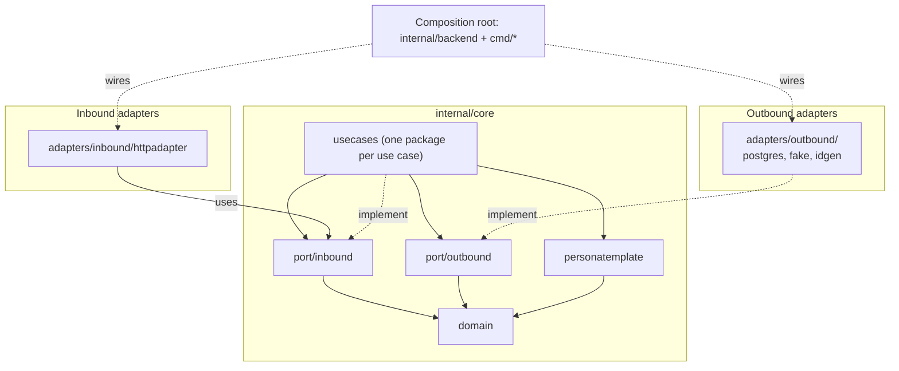

# Backend architecture

The backend is a hexagonal (ports and adapters) Go service. The business rules sit in the middle (`internal/core`). They know nothing about HTTP or SQL. Adapters on the outside translate between the world (HTTP requests, Postgres rows) and the core. Everything is assembled in one place, the composition root.

The layering is not just convention: the depguard rules in [`.golangci.yml`](../.golangci.yml) fail the lint when a package imports something it must not.

## Layers

Arrows show imports. Dependencies point inwards: `domain` ← `personatemplate` ← `usecases`, `domain` ← `port/outbound` ← `usecases`, and `domain` ← `port/inbound` ← `usecases`. Adapters depend on the core, never on each other, and the core never depends on adapters.

## Package map

| Package | Role |
| --- | --- |
| `core/domain` | Entities and their invariants (`Collector`, `Persona`, `ItemDefinition`, `Email`, ids), plus the `domain.Error` type with its kinds (invalid, not found, conflict) and the sentinel errors. Strict import allow-list (`domain-allowlist`). |
| `core/personatemplate` | Predefined personas, the `Locale`/`Localized` types they are written in, the built-in content (`Predefined`), and `Instantiate`, which copies a template into a collector-owned persona. See [Where `personatemplate` lives](#where-personatemplate-lives). |
| `core/port/inbound` | What the core offers: one interface per use case (`CreateCollector`, `GetPersona`, ...) plus their input types (`CreateCollectorCommand`). Inbound adapters depend on these only. Allow-listed to `domain` (`inbound-ports-allowlist`). |
| `core/port/outbound` | What the core needs from the outside: repositories and stores, `Transactor`, id generators. `testutil/porttest` holds contract tests shared by every repository implementation. |
| `core/usecases/<name>` | One package per use case, `New(deps).Execute(...)`. Use cases do not import each other. |
| `adapters/inbound/httpadapter` | Routes, middleware, and one subpackage per resource (`collector`, `persona`, `health`). `httpx` holds shared helpers (JSON, error to status mapping). |
| `adapters/outbound/postgres/<resource>` | Repository implementations on pgx. `pgdb` abstracts pool vs. transaction, `migrations` are embedded SQL. |
| `adapters/outbound/fake/<resource>` | In-memory repositories and transactor for tests. |
| `adapters/outbound/idgen` | Random id generation (`crypto/rand`), implements the `outbound` id generators. |
| `internal/backend` | Composition root: `wire()` builds use cases on repositories and returns the HTTP handler. `Run` migrates, connects, serves, shuts down gracefully. |
| `cmd/docker`, `cmd/e2e` | Entrypoints. `docker` is production; `e2e` (build tag `e2e`) starts a throwaway Postgres and seeds a collector with id `aaaa`. |
| `internal/testutil/{pgtest,postgrestest,porttest,domaintest}` | Test-only helpers (a Postgres testcontainer and its migrated test pool, repository contract tests, domain builders). Must not be imported by production code. The fakes stay next to the real repositories in `adapters/outbound/fake`. |

## Request flow

1. A handler in `httpadapter/<resource>` decodes the request and resolves the collector it acts for with `httpx.Tenant` (today from the URL, later from the authenticated principal).
2. The handler calls a use case through its inbound port (for example `inbound.GetPersona`), passing the collector id as an explicit argument.
3. The use case first checks that the collector exists (`CollectorRepository.GetCollector`, adapters do not do this, see [tenant-scoped-stores.md](tenant-scoped-stores.md)), then asks the store for a repository bound to it (`personas.For(collectorID)`), and works with domain entities. Writes that span several repositories run inside `Transactor.InTx`.
4. The Postgres repository executes the query, always filtered by the bound collector.
5. Errors travel back up as values. `httpx` maps `domain.Error` kinds to status codes (invalid → 400, not found → 404, conflict → 409). Anything else is logged and becomes a generic 500, so internal details never reach the client. A domain error carries only its kind and an English message. The stable machine-readable code clients switch on (`collector_not_found`, ...) is API contract and lives in the adapter, in the table in `httpx/problemcodes.go`. A new sentinel needs an entry there and the code in the `Problem.code` enum of `api/openapi.yaml`; tests fail if either is missing.
   Wrap errors once: use cases name the operation (`get collector: ...`), repositories only name the failing step (`query collector: ...`) and return sentinel errors bare.

## How the layering is enforced

`.golangci.yml` (depguard) encodes these rules, and Go's import cycles cover the opposite directions (for example `port/outbound` cannot import `usecases`):

- `domain` may import only an explicit allow-list. A new import needs a deliberate edit.
- The core must not import adapters, `internal/backend`, `net/http`, `database/sql`, pgx, the migration tool, testcontainers or the logging package. It returns errors and does not log.
- Use cases must not import each other. Shared logic goes into the domain.
- Inbound and outbound adapters must not import each other, and neither may import the composition root. Handlers may not import `port/outbound` or any `usecases` package: they talk to the use cases through `port/inbound`, not to repositories.
- `fake` and `postgres` must not import each other. Each `httpadapter/<x>` and `postgres/<x>` resource package is isolated from its siblings by a `*-isolated` rule.
- Fakes and test helpers (`adapters/outbound/fake` and everything under `internal/testutil`) must not be imported from production code. Test files are exempt, so they can wire real adapters into the core.

## Design decisions and nuances

### Where `personatemplate` lives

`personatemplate` is a separate package inside the core. It is neither part of `domain` nor an adapter.

- **Not in `domain`.** The domain holds aggregates and their invariants and is kept minimal on purpose (strict import allow-list, no id generation, no infrastructure concerns). Templates are seed content plus a copy operation. They need `Locale`/`Localized` and `ErrInvalidLocale`, and these are exactly the things that were moved out of the domain on purpose. Nothing in the domain depends on templates: an instantiated persona is a normal persona and nothing links it back to its template.
- **Not an adapter.** `Instantiate` is business behaviour. It builds personas through the domain constructors (`NewPersona`, `AddItem`) and so enforces the domain rules. It is domain behaviour, so it has to be inside the core.
- **The content is code, not infrastructure.** The list of predefined personas is static business knowledge. It lives in `personatemplate.Predefined()`, with no port or adapter. `createcollector.New` takes the templates as plain data, so tests can pass their own.
- **`Instantiate` is pure.** It takes the persona id and the item ids from the caller (`createcollector` draws them through `outbound.IDGenerator`), so `personatemplate` needs no id interface and does no I/O-flavoured work.
- **Possible later extraction.** `Locale`, `Localized` and `ParseLocale` are not template specific (`createcollector` parses the request locale with them). If locales get more uses, move them to a small `core/locale` package.

### Tenant-scoped stores

A *collector* is the tenant. Everything a collector owns is exposed as a `...Store` whose `For(collectorID)` returns a repository bound to that collector, so repository methods never take a collector id and cannot reach another tenant's rows. Only `CollectorRepository`, the tenant root, is unscoped. The full rules, the cost and the checklist for a new resource are in [tenant-scoped-stores.md](tenant-scoped-stores.md).

Use cases, not adapters, check that the collector exists (`CollectorRepository.GetCollector` before touching a store), so every adapter behaves the same, including the in-memory fakes. Foreign keys in Postgres are only a fallback: they protect integrity if a use case forgets the check or a race slips through, but the business error (`collector_not_found`) never comes from a database constraint. A violated FK surfaces as a 500, which means a bug.

### Inbound and outbound ports

Both kinds of ports live in the core, under `core/port`: `outbound` holds what the core needs (repositories, transactor, id generators), `inbound` holds what it offers. Each use case has one interface in `core/port/inbound` and asserts that it implements it (`var _ inbound.GetPersona = (*Usecase)(nil)`). `httpadapter` handlers and `httpadapter.Deps` use these interfaces and never import a `usecases` package (enforced by depguard). The input of a use case with more than a few arguments is a type next to the interface (`inbound.CreateCollectorCommand`). `backend.wire` assigns the use cases to `Deps`. `Deps` is validated at startup, so a missing wiring fails when the service starts and not on the first request.

Use cases still return domain entities to the adapter. If a read ever needs a projection (counts, joins), add a result type to the inbound port instead of loading whole aggregates.

### Small, pass-through use cases are kept on purpose

Some use cases (`getcollector`, `getpersona`) do little more than check the collector and call a repository with the tenant they are given. They stay. Handlers talk only to use cases and never to `port` (enforced by depguard), so every endpoint goes through the same seam, where authorization, auditing or extra rules can be added later without touching the handlers. Dropping the thin ones would give the HTTP layer two ways to reach the core and would blur the rule that handlers do not know repositories.

### Ids are created outside the domain

The domain does not generate ids. `outbound.IDGenerator` creates the ids of new collectors, personas and items, and `adapters/outbound/idgen` implements it with `crypto/rand`. This keeps the domain deterministic. Collector ids are short strings (see the baseline migration), not UUIDs like in the README diagram, and a generated collector id is not guaranteed to be unused. `createcollector` handles a collision (`ErrCollectorIDTaken`).

### Transactions

The use case owns the transaction, repositories never open one (the `pgdb.DBTX` interface has no `Begin`). `outbound.Transactor.InTx` runs a function with an `outbound.Repositories` that share one transaction and commits only if the function returns nil. A single repository call is atomic on its own: `SavePersona` writes the persona and its items as one pgx batch, which Postgres runs as one implicit transaction. A use case therefore needs `InTx` only when it writes through more than one call (`createcollector`: collector plus personas). Simple reads and single saves use the repositories wired on the pool directly. `postgresRepositories(db)` in `internal/backend` builds the same set on the pool and on a transaction, so the two cannot drift. `Repositories` lists every repository, so each new resource adds a field there and a line in that function; use cases take only the repositories they need from it.

### Repositories have two implementations and one test suite

Every repository interface has a Postgres and a fake implementation. Both run the same contract tests from `testutil/porttest`, including the tenant isolation tests, so the fake used in use case tests cannot drift from the real behaviour. The Postgres tests start their own container with testcontainers, so Docker must be running.

### API contract and migrations

- `api/openapi.yaml` is maintained by hand. `TestOpenAPI_Routes` fails when routes and spec diverge, and the `sync-openapi` skill updates the spec after handler changes.
- Migrations are embedded SQL (`postgres/migrations/NNNN_name.up|down.sql`) applied by `postgres.Migrate` on startup.

### No authentication yet

The tenant is taken from the URL today. The seam is already in place: use cases receive the collector id as an argument and only `httpx.Tenant` resolves it, so authentication will change that one function, not the use cases.

## Adding things

- **A use case:** create `core/usecases/<name>` with `New(deps).Execute`, add the field and the small interface to `httpadapter` (`Deps` and the resource package), and wire it in `backend.wire`.
- **A tenant-owned resource:** follow the checklist in [tenant-scoped-stores.md](tenant-scoped-stores.md).
- **A new `httpadapter/<x>` or `postgres/<x>` package:** add a line for it to the matching `*-isolated` rules in `.golangci.yml`.
- **A new import in `core/domain`:** add it to `domain-allowlist` in `.golangci.yml`, and ask first whether the code belongs in the domain.
- **An endpoint change:** update `api/openapi.yaml` (the `sync-openapi` skill does this).
