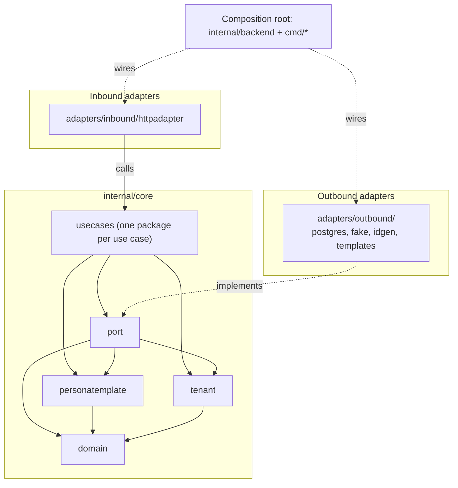

# Backend architecture

The backend is a hexagonal (ports and adapters) Go service. The business rules sit in the middle (`internal/core`). They know nothing about HTTP or SQL. Adapters on the outside translate between the world (HTTP requests, Postgres rows) and the core. Everything is assembled in one place, the composition root.

The layering is not just convention: the depguard rules in [`.golangci.yml`](../.golangci.yml) fail the lint when a package imports something it must not.

## Layers

Arrows show imports. Dependencies point inwards: `domain` ← `personatemplate`, `tenant` ← `port` ← `usecases`. Adapters depend on the core, never on each other, and the core never depends on adapters.

## Package map

| Package | Role |
| --- | --- |
| `core/domain` | Entities and their invariants (`Collector`, `Persona`, `ItemDefinition`, `Email`, ids), plus the `domain.Error` type with its kinds (invalid, not found, conflict) and the sentinel errors. Strict import allow-list (`domain-allowlist`). |
| `core/personatemplate` | Predefined personas, the `Locale`/`Localized` types they are written in, and `Instantiate`, which copies a template into a collector-owned persona. See [Where `personatemplate` lives](#where-personatemplate-lives). |
| `core/tenant` | Carries the collector a request acts for in the `context.Context`. |
| `core/port` | Interfaces the core needs from the outside: repositories and stores, `Transactor`, id generators, `PersonaTemplateCatalog`. `port/porttest` holds contract tests shared by every repository implementation. |
| `core/usecases/<name>` | One package per use case, `New(deps).Execute(...)`. Use cases do not import each other. |
| `adapters/inbound/httpadapter` | Routes, middleware, and one subpackage per resource (`collector`, `persona`, `health`). `httpx` holds shared helpers (JSON, error to status mapping). |
| `adapters/outbound/postgres/<resource>` | Repository implementations on pgx. `pgdb` abstracts pool vs. transaction, `migrations` are embedded SQL, `postgrestest` is a test helper. |
| `adapters/outbound/fake/<resource>` | In-memory repositories and transactor for tests. |
| `adapters/outbound/idgen` | Random id generation (`crypto/rand`), implements the `port` id generators. |
| `adapters/outbound/templates` | The catalog content: the actual predefined personas (`port.PersonaTemplateCatalog`). |
| `internal/backend` | Composition root: `wire()` builds use cases on repositories and returns the HTTP handler. `Run` migrates, connects, serves, shuts down gracefully. |
| `cmd/docker`, `cmd/e2e` | Entrypoints. `docker` is production; `e2e` (build tag `e2e`) starts a throwaway Postgres and seeds a collector with id `aaaa`. |
| `internal/testutil/pgtest`, `core/domaintest` | Test-only helpers (a Postgres testcontainer, domain builders). Must not be imported by production code. |

## Request flow

1. The HTTP middleware resolves the collector from the URL and stores it with `tenant.With` (later: from the authenticated principal).
2. A handler in `httpadapter/<resource>` decodes the request and calls a use case through a small interface it declares itself (for example `collector.Creator`).
3. The use case reads the tenant with `tenant.Require(ctx)`, asks the store for a repository bound to it (`personas.For(collectorID)`), and works with domain entities. Writes that span several repositories run inside `Transactor.InTx`.
4. The Postgres repository executes the query, always filtered by the bound collector.
5. Errors travel back up as values. `httpx` maps `domain.Error` kinds to status codes (invalid → 400, not found → 404, conflict → 409). Anything else is logged and becomes a generic 500, so internal details never reach the client.
   Wrap errors once: use cases name the operation (`get collector: ...`), repositories only name the failing step (`query collector: ...`) and return sentinel errors bare.

## How the layering is enforced

`.golangci.yml` (depguard) encodes these rules, and Go's import cycles cover the opposite directions (for example `port` cannot import `usecases`):

- `domain` may import only an explicit allow-list. A new import needs a deliberate edit.
- The core must not import adapters, `internal/backend`, `net/http`, `database/sql`, pgx, the migration tool, testcontainers or the logging package. It returns errors and does not log.
- Use cases must not import each other. Shared logic goes into the domain.
- Inbound and outbound adapters must not import each other, and neither may import the composition root. Handlers may not import `port`: they talk to use cases, not repositories.
- `fake` and `postgres` must not import each other. Each `httpadapter/<x>` and `postgres/<x>` resource package is isolated from its siblings by a `*-isolated` rule.
- Fakes and test helpers (`fake`, `domaintest`, `porttest`, `postgrestest`, `testutil`) must not be imported from production code. Test files are exempt, so they can wire real adapters into the core.

## Design decisions and nuances

### Where `personatemplate` lives

`personatemplate` is a separate package inside the core. It is neither part of `domain` nor an adapter.

- **Not in `domain`.** The domain holds aggregates and their invariants and is kept minimal on purpose (strict import allow-list, no id generation, no infrastructure concerns). Templates are seed content plus a copy operation. They need `Locale`/`Localized`, `ErrInvalidLocale` and an id-generating interface, and these are exactly the things that were moved out of the domain on purpose. Nothing in the domain depends on templates: an instantiated persona is a normal persona and nothing links it back to its template.
- **Not an adapter.** `Instantiate` is business behaviour. It builds personas through the domain constructors (`NewPersona`, `AddItem`) and so enforces the domain rules. `port.PersonaTemplateCatalog` returns `personatemplate` types, so `port` has to be able to import the package, which means it must be inside the core.
- **Only the content is infrastructure.** The actual list of predefined personas lives in the adapter `adapters/outbound/templates`, behind the `PersonaTemplateCatalog` port.
- **Its own small `IDs` interface is intentional.** It repeats the persona and item parts of the `port` id generators. Importing `port` from `personatemplate` would invert the layering (`personatemplate` sits below `port`), so the local interface stays.
- **Possible later extraction.** `Locale`, `Localized` and `ParseLocale` are not template specific (`createcollector` parses the request locale with them). If locales get more uses, move them to a small `core/locale` package.

### Tenant-scoped stores

A *collector* is the tenant. Everything a collector owns is exposed as a `...Store` whose `For(collectorID)` returns a repository bound to that collector, so repository methods never take a collector id and cannot reach another tenant's rows. Only `CollectorRepository`, the tenant root, is unscoped. The full rules, the cost and the checklist for a new resource are in [tenant-scoped-stores.md](tenant-scoped-stores.md).

### No inbound port types

There are no inbound port interfaces in `core/port`. Each `httpadapter` resource package declares the small interface it needs from a use case (`collector.Creator`, `persona.Getter`, ...), and `backend.wire` assigns the use cases to them through `httpadapter.Deps`. `Deps` is validated at startup, so a missing wiring fails when the service starts and not on the first request.

### Ids are created outside the domain

The domain does not generate ids. `port.CollectorIDGenerator`, `PersonaIDGenerator` and `ItemIDGenerator` are separate small interfaces, and `adapters/outbound/idgen` implements them with `crypto/rand`. This keeps the domain deterministic. Collector ids are short strings (see the baseline migration), not UUIDs like in the README diagram, and a generated collector id is not guaranteed to be unused. `createcollector` handles a collision (`ErrCollectorIDTaken`).

### Transactions

`port.Transactor.InTx` runs a function with a `port.Repositories` that share one transaction, and commits only if the function returns nil. Simple reads use the repositories wired on the pool directly. Writes spanning several repositories go through the transactor. `postgresRepositories(db)` in `internal/backend` builds the same set on either the pool or a transaction.

### Repositories have two implementations and one test suite

Every repository interface has a Postgres and a fake implementation. Both run the same contract tests from `port/porttest`, including the tenant isolation tests, so the fake used in use case tests cannot drift from the real behaviour. The Postgres tests start their own container with testcontainers, so Docker must be running.

### API contract and migrations

- `api/openapi.yaml` is maintained by hand. `TestOpenAPI_Routes` fails when routes and spec diverge, and the `sync-openapi` skill updates the spec after handler changes.
- Migrations are embedded SQL (`postgres/migrations/NNNN_name.up|down.sql`) applied by `postgres.Migrate` on startup.

### No authentication yet

The tenant is taken from the URL today. The seam is already in place: use cases only read `tenant.Require(ctx)`, so authentication will change how the middleware fills the context, not the use cases.

## Adding things

- **A use case:** create `core/usecases/<name>` with `New(deps).Execute`, add the field and the small interface to `httpadapter` (`Deps` and the resource package), and wire it in `backend.wire`.
- **A tenant-owned resource:** follow the checklist in [tenant-scoped-stores.md](tenant-scoped-stores.md).
- **A new `httpadapter/<x>` or `postgres/<x>` package:** add a line for it to the matching `*-isolated` rules in `.golangci.yml`.
- **A new import in `core/domain`:** add it to `domain-allowlist` in `.golangci.yml`, and ask first whether the code belongs in the domain.
- **An endpoint change:** update `api/openapi.yaml` (the `sync-openapi` skill does this).
