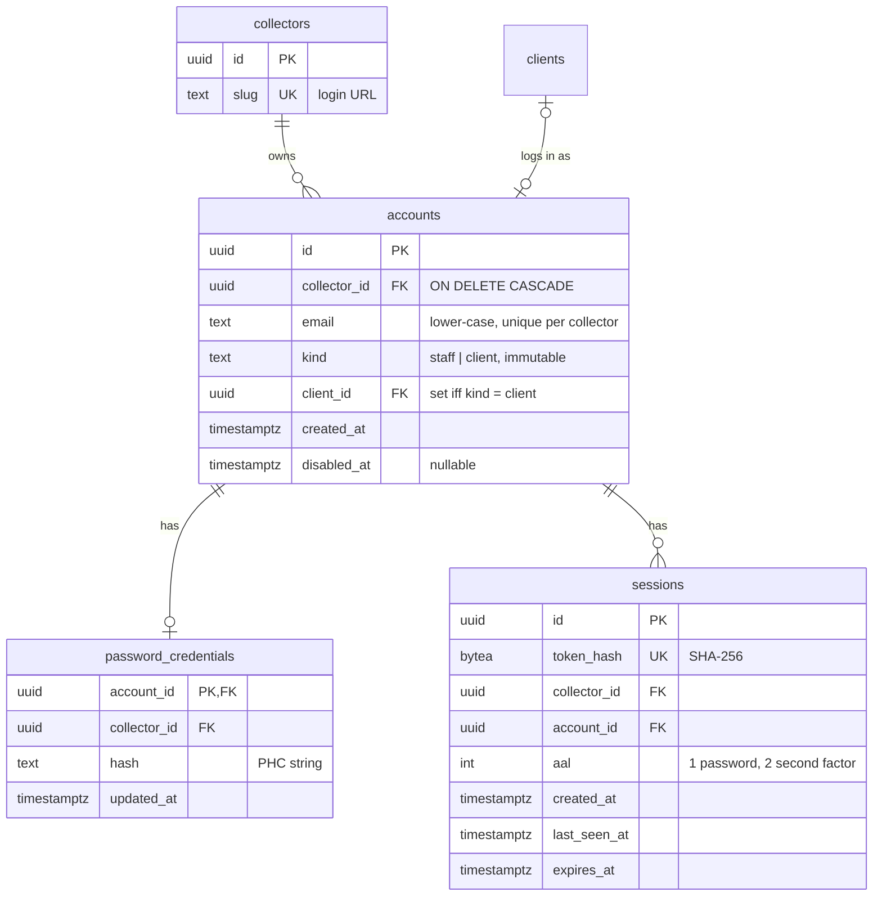
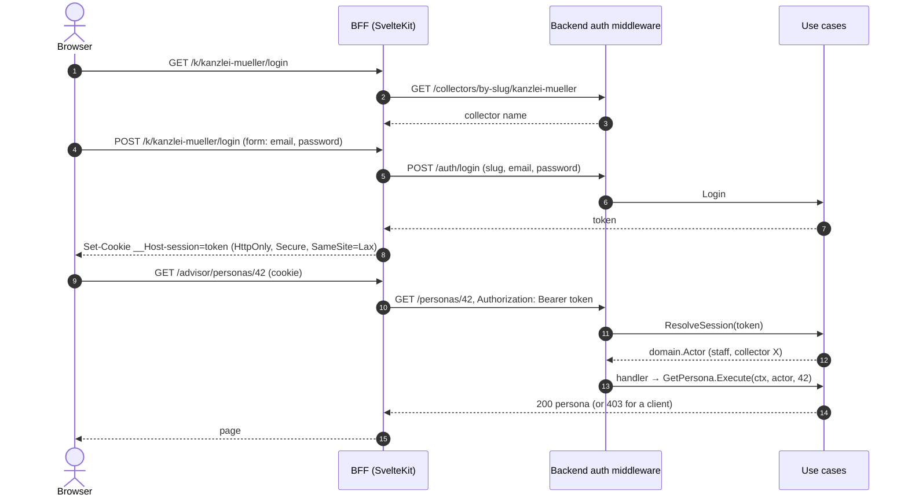

# Authentication

> Status: design, nothing of it is built yet. Today every request is treated as an employee of the `{collectorId}` in the URL (see [No authentication yet](ARCHITECTURE.md#no-authentication-yet)).

How users log in, how credentials and sessions are stored, and how a request like `GET /personas/{id}` learns who is calling. The authorization rules themselves (what an actor may do) stay in the use cases, as described in [Actors and authorization](ARCHITECTURE.md#actors-and-authorization).

## Decisions at a glance

| Question | Decision |
| --- | --- |
| Separate auth service or part of the backend? | Part of the backend, behind ports. An external OIDC provider can replace it later without touching the use cases. |
| How are users modelled? | An **account** (email, credentials) belongs to exactly one collector and is either a staff account or a client account there, never both. A person who is a client of two collectors has two accounts. |
| Which collector does a login belong to? | The login URL names it: `/k/{slug}/login`, with a unique slug per collector. |
| How are passwords stored? | Hashed with argon2id (never encrypted), salted, as a PHC string. Session tokens are stored only as SHA-256 hashes. |
| Who is responsible under DSGVO? | Each collector, for everything including its accounts. The operator is its processor under the AVV. There is no account data shared across collectors. |
| Is authentication an outbound port? | Partly. Login is something the core *offers* (inbound port). Hashing, account and session storage are what it *needs* (outbound ports). The HTTP middleware is an inbound adapter. |
| Basic auth now, 2FA later? | Email and password now. Login is a small state machine with an assurance level on the session, so a second factor plugs in without a redesign. |
| Collector vs client? | The account's kind is its role. A session belongs to one account, so every request runs as exactly one `domain.Actor` with one role. |
| How does a request know who is logged in? | The BFF holds the session in an HttpOnly cookie and sends it as a bearer token. A backend middleware resolves it to a `domain.Actor` through the core, and the handler passes the actor to the use case as an argument, as today. |
| Mock authenticator for e2e? | No auth bypass in any binary. `cmd/e2e` seeds real accounts with known passwords. Unit tests use stubs and a fake hasher, and BFF Playwright tests mock the auth endpoints. |

## Where authentication lives

Authentication is a part of the existing backend, not a microservice.

- Accounts, clients and collectors live in the same Postgres. Inviting a client creates the client and its account together. Across services that would need distributed consistency for no gain.
- A second service would need its own deployment, its own database and service-to-service authentication, all for one team and one product.
- The hexagonal layout already gives the boundary a service would give. The core only knows the ports below. If authentication moves out later, `ResolveSession` gets a new adapter and the use cases do not change.

Reasons to revisit the decision: a second backend service that needs to authenticate users, collectors asking for SSO (SAML/OIDC with their own directory), or the effort for 2FA, WebAuthn and recovery growing beyond what is worth owning. The way out is then a self-hosted OIDC provider (Keycloak or Zitadel, run in the EU), with the backend verifying its tokens behind the same port.

## Accounts and sessions

- **Account.** An `accounts` row is a login at one collector: an email (stored lower-case, unique per collector) and its `kind`, `staff` (an employee) or `client` (then `client_id` points at the `Client` record of the same collector, by the composite foreign key `(client_id, collector_id)`). The kind is set when the account is created and never changes, and a CHECK ensures that `client_id` is set exactly for clients. Credentials are in their own tables (`password_credentials` now, `totp_credentials`/`webauthn_credentials` later), so adding a factor adds a table and does not change `accounts`.
- **What follows from the schema.** A staff account is an employee of exactly one collector, and a client account is a client of exactly one collector. An account is never both: an employee who files their own return with the firm uses a separate client account with another email. A person who is a client of two collectors has two accounts, with the same email if they like, but separate passwords.
- **Accounts are tenant-owned.** They are exposed as an `AccountStore` whose `For(collectorID)` returns a repository bound to that collector, like every other tenant resource (see [tenant-scoped-stores.md](tenant-scoped-stores.md)). `accounts` and `password_credentials` carry `collector_id` and get row-level security policies like every tenant table.
- **Slug.** Each collector has a slug: lower-case `[a-z0-9-]`, 3 to 63 characters, unique, set by the operator when the collector is created and **never changed**, so login and invite links stay valid and no redirects for old slugs are needed. It is part of the login URL (`/k/kanzlei-mueller/login`), so it is public by nature. The login page shows the collector's name through `GET /collectors/by-slug/{slug}`, which answers with the name only.
- **Login.** `Login` gets slug, email and password. It resolves the slug through the unscoped `CollectorRepository` (the tenant root), then reads the account through `accounts.For(collectorID)`. From there on the tenant is known, as in every other use case.
- **Session.** It belongs to one account and carries that account's collector id. There is nothing to pick after login. Logging in at another collector in the same browser replaces the session.
- **A collector is not a user.** Its employees are. There is no self-service signup: the operator creates a collector with the `docker create-collector` subcommand, giving its name, slug and the owner's email, and `createcollector` creates it together with the owner's staff account, who is invited by email. `POST /collectors` is removed from the API then. Further employees and all clients are invited. Clients never register themselves. See [roadmap #3](ARCHITECTURE_ROADMAP.md#3-collectors-are-created-by-the-operator).
- **Invites.** A collector invites a client or an employee by email. The invite token identifies the collector, and accepting it lets the person set a password and creates the account in that collector. If the email is already used by an account of the same collector, the invite is refused with 409 `email_taken`. That answer may be honest: the collector knows its own accounts anyway, and accounts of other collectors are not visible at all.
- **`domain.Actor` changes.** It is built from an account: role (the kind), collector, the account id as user id, and for clients the client id. The current rule "a client's user id is its client id" is dropped, because staff and clients now have account ids of the same kind and the client record can exist before its account (until the invite is accepted).
- **Only the sessions are unscoped.** A request carries only its token, so `SessionStore` looks up a session by token hash before the tenant is known. It is a deliberate exception to [tenant-scoped-stores.md](tenant-scoped-stores.md), like `CollectorRepository`. Only the auth use cases take it, and review checks that, as it does for `Transactor`. Once the session is found, its account is read through `accounts.For(session.collectorID)`.

### Why accounts are bound to one collector

A single login shared across collectors would be data that belongs to no single collector. The operator would become its controller under DSGVO, with its own privacy notice and terms for every client, and would answer requests about account data itself. Binding accounts to one collector avoids that: an account is simply more data of the collector, covered by the same AVV as everything else.

It also keeps the design small. There are no memberships, no tenant picker, no "select tenant" step, no need to hide from collector A that a person is also known to collector B, and the account tables get row-level security like every tenant table. The cost is that a client of two collectors has two logins, which is rare.

## Storing credentials securely (DSGVO)

### Passwords

- **Hashed, never encrypted.** An encrypted password can be decrypted by whoever has the key. A hash cannot be reversed. Use **argon2id** with at least the OWASP parameters (memory 19 MiB, 2 iterations, parallelism 1; raise them as far as login latency allows, measured on the production hardware), with a random 16-byte salt per hash.
- **PHC string format** (`$argon2id$v=19$m=19456,t=2,p=1$<salt>$<hash>`): the parameters are stored with each hash. When the parameters are raised, a successful login with an old hash rehashes the password. `PasswordHasher.Verify` reports `needsRehash` for this.
- Comparison in constant time (`crypto/subtle`), done inside the hasher.
- **No user enumeration.** An unknown slug, an unknown email and a wrong password all answer 401 `invalid_credentials`. If there is no account to check, the use case still verifies against a fixed dummy hash, so all cases take the same time.
- **Throttling.** Failed attempts are counted per account (collector and email) and per client IP, with growing delays and then a temporary block (429 `too_many_attempts`). There is no permanent lockout, because that would let anyone lock out a known email.
- **Password rules** per NIST SP 800-63B: at least 12 characters, at most 128 (bounds the hashing cost), no rules about character classes, no forced rotation. Optionally reject known breached passwords (k-anonymity check against Have I Been Pwned, so the password never leaves the server).

### Session tokens

32 random bytes from `crypto/rand`, sent to the BFF once. The database stores only the SHA-256 of the token. A leaked database therefore contains no usable session. A fast hash is enough here (unlike for passwords), because the token is random and long.

### DSGVO points

Tax documents are not a special category under Art. 9 DSGVO, but they are highly sensitive, and tax advisors are bound by professional secrecy (§ 203 StGB, § 57 StBerG). That raises what counts as appropriate under Art. 32.

- **Who is responsible.** Each collector is the controller for all of its data, its accounts included, and the operator of this system is its processor (data processing agreement, AVV, Art. 28). The AVV and the collector's privacy notice name the accounts as well (see Open questions).
- **Art. 32 (security of processing).** Salted argon2id hashes, hashed session tokens, TLS everywhere, the backend not reachable from the internet, row-level security on the account tables. **2FA for staff** should be offered early and probably required, because staff accounts see all clients of a collector.
- **Art. 5(1)(c) (data minimisation).** An account holds an email, its kind and a password hash. No name, phone number or birth date for authentication. Names belong to the `Client` record.
- **Art. 17 (erasure).** Deleting a client or an employee deletes its account, credentials and sessions (`ON DELETE CASCADE`), and deleting a collector deletes all of its accounts. A client who wants their data erased asks the collector, which is the controller. A self-service "end my access" may be offered later. It deletes only the account (the login), **never the documents**: they are the collector's records, which tax advisors must keep (Handakten, § 66 StBerG; the client's own records, § 147 AO). Deleting them stays the collector's decision.
- **Logs.** Never log passwords, tokens or token hashes. Emails and IP addresses are personal data: log the account id instead of the email. Keep security events (logins, failed logins) in an audit log with a fixed retention (e.g. 90 days), and record that in the record of processing activities (Verzeichnis von Verarbeitungstätigkeiten, Art. 30).
- **Isolation between tenants.** An account exists in exactly one tenant, so no answer can tell one collector anything about another.
- **Hosting** of the database, backups and the email provider (invites, password reset) in the EU.

## Ports and adapters

"Authentication" is not one port. The core **offers** login (inbound), and for that it **needs** storage, hashing and randomness (outbound). Recognising the session on an HTTP request is the job of an inbound adapter (middleware). The decision of what the resolved actor may do stays in the use cases.

| Kind | Port | Responsibility |
| --- | --- | --- |
| inbound | `Login` | slug, email and password → `LoginResult`: a session token (later: `SecondFactorRequired` instead) |
| inbound | `Logout` | deletes the session |
| inbound | `ResolveSession` | token → `domain.Actor` (or `unauthenticated`), extends the idle timeout. Replaces the `ResolveActor` planned in ARCHITECTURE.md |
| outbound | `CollectorRepository` | gains `BySlug`, for the login and the login page |
| outbound | `AccountStore` | tenant-scoped: `For(collectorID)` → account by email or id, its password credential |
| outbound | `SessionStore` | unscoped: create, get by token hash, touch, delete, delete all of an account |
| outbound | `PasswordHasher` | `Hash(password)`, `Verify(hash, password) → (ok, needsRehash)` |
| outbound | `TokenGenerator`, `Clock` | random tokens, the current time (so expiry is testable) |

- **Adapters:** `adapters/outbound/argon2` (the hasher, the only package that imports `golang.org/x/crypto/argon2`), `postgres/{account,session}`, running the contract tests in `testutil/porttest` against Postgres. There are no in-memory repositories. A fake hasher keeps the use case tests fast.
- **Domain:** `Collector` gets its slug. A new error kind `unauthenticated` → 401. Problem codes `unauthenticated`, `invalid_credentials`, `too_many_attempts`, `email_taken` go into `httpx/problemcodes.go` and the `Problem.code` enum in `api/openapi.yaml`.
- **depguard:** the new `httpadapter/auth` and `postgres/{account,session}` packages need their lines in the `*-isolated` rules of `.golangci.yml`.

## Ready for a second factor

Only email and password are built first, but the flow already has the steps a second factor needs:

1. `Login` checks the password. If the account has no second factor, it creates a session with `aal = 1` and is done.
2. If it has one, `Login` creates a session with `aal = 1` that `ResolveSession` does not accept yet, and returns `SecondFactorRequired`.
3. `POST /auth/login/second-factor` checks the code (TOTP) or the assertion (WebAuthn) and raises the session to `aal = 2` (with token rotation).

Each factor gets its own credential table: a TOTP secret is encrypted at rest with a key from the environment, because the server must read it to check codes; recovery codes are hashed like passwords. A per-collector policy ("staff must use 2FA") is then a check in `ResolveSession` on the account's kind and the session's `aal`.

## Request flow

The browser only talks to the BFF. The backend is not reachable from the internet.

### BFF

- **Login page** `/k/[slug]/login` with a SvelteKit form action. The page shows the collector's name. An unknown slug shows a 404 page. On success it sets the cookie `__Host-session` (HttpOnly, Secure, SameSite=Lax, Path=/; the `__Host-` prefix forbids a Domain attribute) and redirects by role to the staff area (`/advisor/...`) or the client area (`/client/...`). Password reset lives next to it (`/k/[slug]/reset`, later).
- **`handleAuth`** in `hooks.server.ts` replaces `handleTenant`. It reads the cookie, asks the backend `GET /auth/session` and sets `event.locals.actor` (role, collector id, slug and name) instead of `locals.tenantID`. The `TENANT_ID` variable in `env.ts` is removed.
- **Route groups** `(staff)` and `(client)` check the role in their `+layout.server.ts`. Logout redirects to the collector's login page (`/k/{slug}/login`). A 401 from the backend anywhere deletes the cookie and redirects to a login page: the collector's, if its slug is still known from the last session, otherwise a neutral page asking the user to use their advisory's link.
- **CSRF:** SameSite=Lax plus SvelteKit's built-in origin check on form actions cover the BFF. The backend takes a bearer header, not a cookie, so it is not exposed to CSRF.

### Backend

- **The backend checks the token itself.** It never trusts identity headers such as `X-User-Id` set by the BFF. Otherwise anything that can reach the backend inside the network could act as any user.
- An **`authenticate` middleware** in `httpadapter` denies by default. The only routes without a session are `GET /healthz`, `GET /readyz`, `GET /collectors/by-slug/{slug}`, `POST /auth/login` and accepting an invite (later also password reset). It calls `ResolveSession`, puts the actor on the request context, and answers 401 when the token is missing, unknown or expired.
- **`httpx.Actor`** takes the actor from the context (and answers 401 if there is none) instead of building a staff actor from `{collectorId}`. The handler passes it to the use case **as an argument**, exactly as today. The core never reads the context.
- **Routes lose `{collectorId}`:** `GET /collectors/{collectorId}/personas/{id}` becomes `GET /personas/{id}`, and the tenant is `actor.CollectorID()`. A client can then not even name another tenant.

Example `GET /personas/{id}`:

1. The middleware hashes the bearer token. `ResolveSession` finds the session, reads its account through `accounts.For(session.collectorID)` (staff of collector X) and returns `NewStaffActor(X, account)`.
2. The handler calls `GetPersona.Execute(ctx, actor, id)`.
3. `getpersona` calls `actor.RequireStaff()` and reads through `personas.For(actor.CollectorID())`. A persona of another collector is not found (404). A client actor gets 403 before any repository is asked.

### Sessions

Sessions are opaque random tokens kept in Postgres, not JWTs. One lookup per request is cheap at this scale, and a server-side session can be revoked at once. That matters here:

- logout deletes the session,
- a password change deletes all sessions of the account,
- a deleted account deletes its sessions,
- raising `aal` rotates the token (no session fixation).

A JWT would only pay off with several services verifying tokens without a shared database, which is not the case. Timeouts: idle 30 minutes (`last_seen_at`, extended by `ResolveSession`), absolute 12 hours (`expires_at`), both configurable via environment variables. Expired sessions are deleted by a periodic cleanup.

## API sketch

Goes into `api/openapi.yaml` when it is built (with the `sync-openapi` skill).

| Endpoint | Auth | Purpose |
| --- | --- | --- |
| `GET /collectors/by-slug/{slug}` | public | the collector's name, for the login page |
| `POST /auth/login` | public | slug + email + password → token |
| `POST /auth/login/second-factor` | session (aal 1) | later: code → aal 2 |
| `GET /auth/session` | session | the current actor and its collector's slug and name, for the BFF |
| `POST /auth/logout` | session | delete the session |
| `POST /clients/{id}/invite` | staff | invite a client by email |
| `POST /invites/{token}/accept` | public | set a password, creates the account |
| password reset | public | later, needs email sending |

## Tests and the e2e environment

- **No mock authenticator in any binary, and no "auth disabled" flag.** A switch like that is one wrong environment variable away from an open production system. The e2e environment runs the real authentication.
- **`cmd/e2e`** seeds real accounts through the real use cases, with fixed ids, slugs and passwords as documented constants (like today's collector `00000000-0000-4000-8000-00000000aaaa`):
  - collector `…aaaa`, slug `e2e`: `staff@e2e.test` (staff) and `client@e2e.test` (client),
  - collector `…bbbb`, slug `e2e-b`: its own `client@e2e.test` account with a different password, so tests can check that a login at one collector never works at the other.

  The argon2 parameters can be lowered by configuration in e2e only, to keep logins fast.
- **Use case tests** use stub repositories defined in the test file, the fake hasher, a fixed `Clock` and a predictable `TokenGenerator`.
- **Repository tests:** the new Postgres repositories run the `porttest` contract tests, including the tenant isolation tests every tenant store runs. They also check that the same email at two collectors gives two accounts, that `accounts.For(B)` never sees an account of A, that a session of account A never resolves to another account, that an expired session never resolves, and that the database rejects a client account without a client and a staff account with one.
- **BFF Playwright tests** keep mocking the backend inside the test files. They get fixtures for `GET /collectors/by-slug/{slug}`, `POST /auth/login` and `GET /auth/session` (staff, client, unknown slug, 401), and a helper that logs a test in by setting the session cookie directly.

## Implementation order

Seeding clients needs the `Client` entity and a create-client use case, which do not exist yet. They come first or together with step 4.

1. Domain and ports: the collector's slug, the account, `Actor` built from an account (with a client id), the `unauthenticated` error kind.
2. Migrations, Postgres repositories and contract tests, argon2 hasher.
3. `Login`, `Logout`, `ResolveSession`. The `authenticate` middleware, `httpx.Actor` from the context, routes without `{collectorId}`, openapi. The tenant-scoped repositories drop their collector existence checks ([roadmap #4](ARCHITECTURE_ROADMAP.md#4-drop-the-collector-existence-checks-with-authentication)).
4. `createcollector` with its slug and the owner's staff account, run by the operator through `docker create-collector`; `POST /collectors` is removed. e2e seeds.
5. BFF: login page under `/k/[slug]`, `handleAuth`, route groups, removing `TENANT_ID`, Playwright fixtures.
6. Later: invites and password reset (need an email provider), stricter throttling, 2FA, "end my access".

## Open questions

- Template text for collectors: the AVV and their privacy notice should name the accounts (email, password hash, login logs) as processed data.
- Which EU email provider sends invites and password resets?
- Is 2FA required for staff from the first release?
