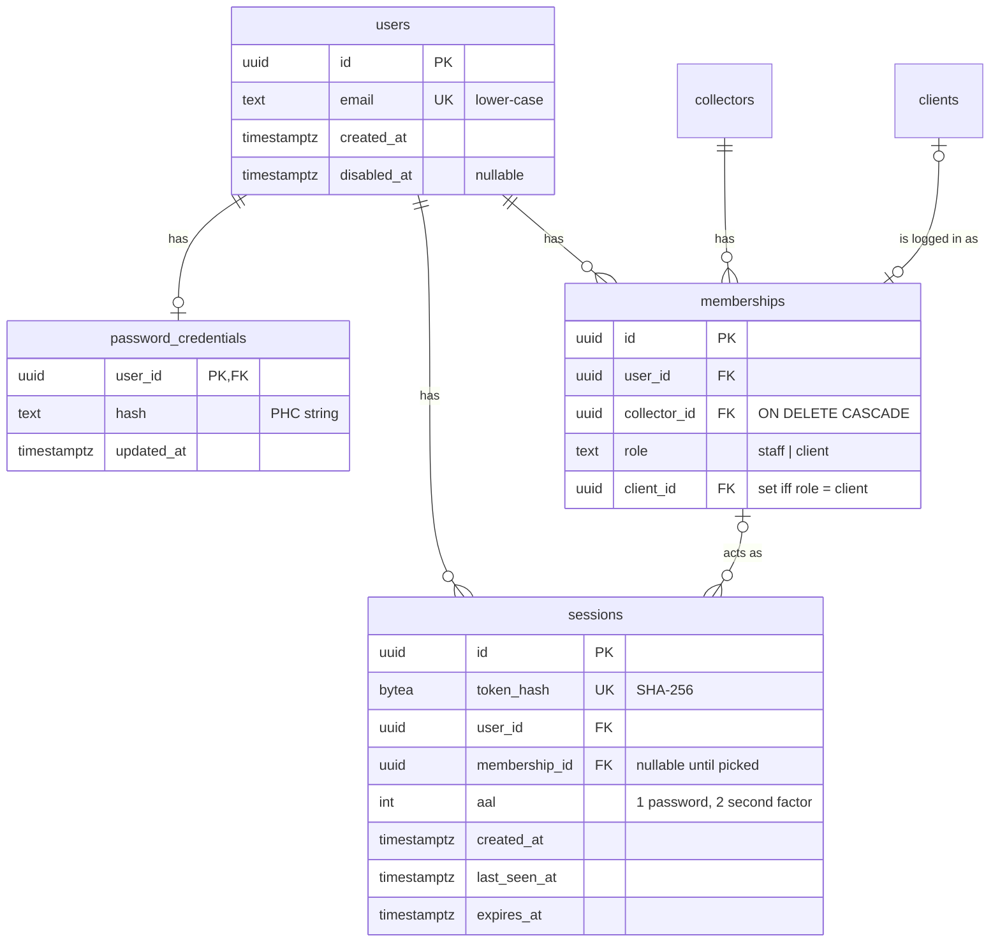
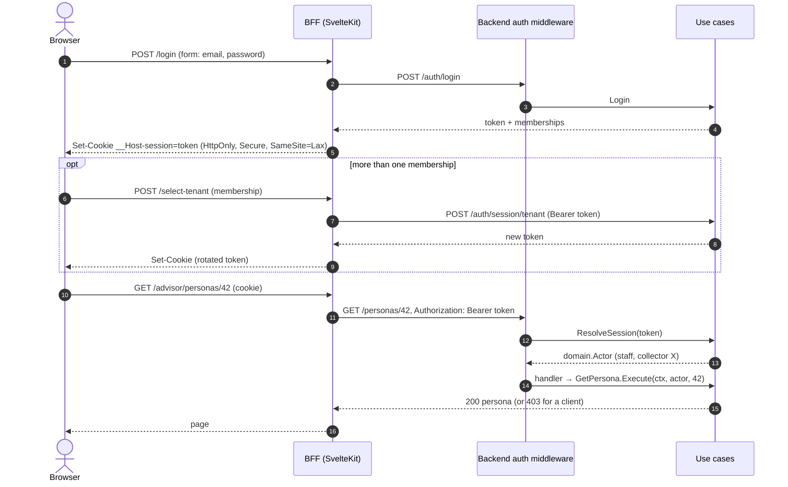

# Authentication

> Status: design, nothing of it is built yet. Today every request is treated as an employee of the `{collectorId}` in the URL (see [No authentication yet](ARCHITECTURE.md#no-authentication-yet)).

How users log in, how credentials and sessions are stored, and how a request like `GET /personas/{id}` learns who is calling. The authorization rules themselves (what an actor may do) stay in the use cases, as described in [Actors and authorization](ARCHITECTURE.md#actors-and-authorization).

## Decisions at a glance

| Question | Decision |
| --- | --- |
| Separate auth service or part of the backend? | Part of the backend, behind ports. An external OIDC provider can replace it later without touching the use cases. |
| How are users modelled? | One **identity** (email, credentials) with any number of **memberships** (collector + role, plus the client for clients). A person can be a client of several collectors, and an employee and a client of the same one. |
| How are passwords stored? | Hashed with argon2id (never encrypted), salted, as a PHC string. Session tokens are stored only as SHA-256 hashes. |
| Is authentication an outbound port? | Partly. Login is something the core *offers* (inbound port). Hashing, user/membership/session storage are what it *needs* (outbound ports). The HTTP middleware is an inbound adapter. |
| Basic auth now, 2FA later? | Email and password now. Login is a small state machine with an assurance level on the session, so a second factor plugs in without a redesign. |
| Collector vs client? | The role sits on the membership. The session is bound to one membership, so every request runs as exactly one `domain.Actor` with one role. |
| How does a request know who is logged in? | The BFF holds the session in an HttpOnly cookie and sends it as a bearer token. A backend middleware resolves it to a `domain.Actor` through the core, and the handler passes the actor to the use case as an argument, as today. |
| Mock authenticator for e2e? | No auth bypass in any binary. `cmd/e2e` seeds real accounts with known passwords. Unit tests use stubs and a fake hasher, and BFF Playwright tests mock the auth endpoints. |

## Where authentication lives

Authentication is a part of the existing backend, not a microservice.

- Identities, memberships, clients and collectors live in the same Postgres. Inviting a client creates the client and its membership together. Across services that would need distributed consistency for no gain.
- A second service would need its own deployment, its own database and service-to-service authentication, all for one team and one product.
- The hexagonal layout already gives the boundary a service would give. The core only knows the ports below. If authentication moves out later, `ResolveSession` gets a new adapter and the use cases do not change.

Reasons to revisit the decision: a second backend service that needs to authenticate users, collectors asking for SSO (SAML/OIDC with their own directory), or the effort for 2FA, WebAuthn and recovery growing beyond what is worth owning. The way out is then a self-hosted OIDC provider (Keycloak or Zitadel, run in the EU), with the backend verifying its tokens behind the same port.

## Identity, membership, session

- **Identity.** A `users` row is a person: an email (unique, stored lower-case) and nothing else. Credentials are in their own tables (`password_credentials` now, `totp_credentials`/`webauthn_credentials` later), so adding a factor adds a table and does not change `users`.
- **Membership.** What the person is to a collector: `staff` (an employee) or `client` (then `client_id` points at the `Client` record of that collector). The unique key is (`user_id`, `collector_id`, `role`). So one person can
  - be a client of several collectors (one membership each), and
  - be an employee **and** a client of the same collector, e.g. an employee who files their own return with the firm.
- **Session.** It is bound to the identity first and to one membership once a tenant is picked. A request never runs "as a person", always as one membership, so the `Actor` is never ambiguous. With more than one membership the user picks one after login. The picker lists memberships, not collectors ("Kanzlei X – Mitarbeiter", "Kanzlei X – Mandant"), and switching role works the same way as switching tenant.
  An employee who is also a client sees their own client record in the staff role, like every other client. That is accepted for now and visible in the audit log. Whether they may edit their own tax year as staff is an open question.
- **A collector is not a user.** Its employees are. There is no self-service signup: the operator creates a collector with the `docker create-collector` subcommand, and `createcollector` creates it together with its first staff identity (the owner), who is invited by email. `POST /collectors` is removed from the API then. Further employees and all clients are invited. Clients never register themselves. See [roadmap #3](ARCHITECTURE_ROADMAP.md#3-collectors-are-created-by-the-operator).
- **Invites.** A collector invites a client by email. If the email has no identity yet, the invite link lets the person set a password. If it already has one, accepting the invite only adds the membership. The collector gets the same answer in both cases, so it cannot find out that the person is known to another collector.
- **`domain.Actor` changes.** It is built from a membership: role, collector, the user id of the identity, and for clients the client id. The current rule "a client's user id is its client id" is dropped, because one identity can be several clients (one per collector).
- **Unscoped repositories.** At login no tenant is known yet, so `UserRepository`, `MembershipRepository` and `SessionStore` are not tenant-scoped, like `CollectorRepository`. This is a deliberate exception to [tenant-scoped-stores.md](tenant-scoped-stores.md). Only the auth use cases take these repositories, and review checks that, as it does for `Transactor`. Everything a membership leads to (clients, tax years) stays tenant-scoped.

## Storing credentials securely (DSGVO)

### Passwords

- **Hashed, never encrypted.** An encrypted password can be decrypted by whoever has the key. A hash cannot be reversed. Use **argon2id** with at least the OWASP parameters (memory 19 MiB, 2 iterations, parallelism 1; raise them as far as login latency allows, measured on the production hardware), with a random 16-byte salt per hash.
- **PHC string format** (`$argon2id$v=19$m=19456,t=2,p=1$<salt>$<hash>`): the parameters are stored with each hash. When the parameters are raised, a successful login with an old hash rehashes the password. `PasswordHasher.Verify` reports `needsRehash` for this.
- Comparison in constant time (`crypto/subtle`), done inside the hasher.
- **No user enumeration.** An unknown email and a wrong password both answer 401 `invalid_credentials`. For an unknown email the use case still verifies against a fixed dummy hash, so both cases take the same time.
- **Throttling.** Failed attempts are counted per identity and per client IP, with growing delays and then a temporary block (429 `too_many_attempts`). There is no permanent lockout, because that would let anyone lock out a known email.
- **Password rules** per NIST SP 800-63B: at least 12 characters, at most 128 (bounds the hashing cost), no rules about character classes, no forced rotation. Optionally reject known breached passwords (k-anonymity check against Have I Been Pwned, so the password never leaves the server).

### Session tokens

32 random bytes from `crypto/rand`, sent to the BFF once. The database stores only the SHA-256 of the token. A leaked database therefore contains no usable session. A fast hash is enough here (unlike for passwords), because the token is random and long.

### DSGVO points

Tax documents are not a special category under Art. 9 DSGVO, but they are highly sensitive, and tax advisors are bound by professional secrecy (§ 203 StGB, § 57 StBerG). That raises what counts as appropriate under Art. 32.

- **Art. 32 (security of processing).** Salted argon2id hashes, hashed session tokens, TLS everywhere, the backend not reachable from the internet. **2FA for staff** should be offered early and probably required, because staff accounts see all clients of a collector.
- **Art. 5(1)(c) (data minimisation).** An identity holds an email and a password hash. No name, phone number or birth date for authentication. Names belong to the `Client` record of the collector that needs them.
- **Art. 17 (erasure).** Removing a membership (a collector deletes a client, an employee leaves) deletes the membership and its sessions, not the identity. The identity is deleted with its last membership or when the person asks for it. Its credentials and sessions are deleted with it (`ON DELETE CASCADE`).
- **Logs.** Never log passwords, tokens or token hashes. Emails and IP addresses are personal data: log the user id instead of the email. Keep security events (logins, failed logins, role switches) in an audit log with a fixed retention (e.g. 90 days), and record that in the record of processing activities (Verzeichnis von Verarbeitungstätigkeiten, Art. 30).
- **Who is responsible.** Each collector is the controller for its clients' data, and the operator of this system is its processor (data processing agreement, AVV, Art. 28). A shared identity across collectors is data that belongs to no single collector, so the operator is likely its controller. This needs legal review and a section in the privacy policy.
- **Isolation between tenants.** No API answer may let collector A learn that a person also has a membership at collector B (see Invites above). Only the person sees their own list of memberships.
- **Hosting** of the database, backups and the email provider (invites, password reset) in the EU.

## Ports and adapters

"Authentication" is not one port. The core **offers** login (inbound), and for that it **needs** storage, hashing and randomness (outbound). Recognising the session on an HTTP request is the job of an inbound adapter (middleware). The decision of what the resolved actor may do stays in the use cases.

| Kind | Port | Responsibility |
| --- | --- | --- |
| inbound | `Login` | email and password → `LoginResult`: a session token plus the memberships to choose from (later: `SecondFactorRequired` instead) |
| inbound | `SelectTenant` | binds the session to one of the user's memberships and rotates the token |
| inbound | `Logout` | deletes the session |
| inbound | `ResolveSession` | token → `domain.Actor` (or `unauthenticated`), extends the idle timeout. Replaces the `ResolveActor` planned in ARCHITECTURE.md |
| outbound | `UserRepository` | identity by email or id, its password credential |
| outbound | `MembershipRepository` | memberships of an identity |
| outbound | `SessionStore` | create, get by token hash, touch, delete, delete all of an identity |
| outbound | `PasswordHasher` | `Hash(password)`, `Verify(hash, password) → (ok, needsRehash)` |
| outbound | `TokenGenerator`, `Clock` | random tokens, the current time (so expiry is testable) |

- **Adapters:** `adapters/outbound/argon2` (the hasher, the only package that imports `golang.org/x/crypto/argon2`), `postgres/{user,membership,session}`, running the contract tests in `testutil/porttest` against Postgres. There are no in-memory repositories. A fake hasher keeps the use case tests fast.
- **Domain:** a new error kind `unauthenticated` → 401. Problem codes `unauthenticated`, `invalid_credentials`, `too_many_attempts`, `tenant_selection_required` go into `httpx/problemcodes.go` and the `Problem.code` enum in `api/openapi.yaml`.
- **depguard:** the new `httpadapter/auth` and `postgres/{user,membership,session}` packages need their lines in the `*-isolated` rules of `.golangci.yml`.

## Ready for a second factor

Only email and password are built first, but the flow already has the steps a second factor needs:

1. `Login` checks the password. If the identity has no second factor, it creates a session with `aal = 1` and is done.
2. If it has one, `Login` creates a session with `aal = 1` that `ResolveSession` does not accept yet, and returns `SecondFactorRequired`.
3. `POST /auth/login/second-factor` checks the code (TOTP) or the assertion (WebAuthn) and raises the session to `aal = 2` (with token rotation).

Each factor gets its own credential table: a TOTP secret is encrypted at rest with a key from the environment, because the server must read it to check codes; recovery codes are hashed like passwords. A per-collector policy ("staff must use 2FA") is then a check in `ResolveSession` on the membership's role and the session's `aal`.

## Request flow

The browser only talks to the BFF. The backend is not reachable from the internet.

### BFF

- **Login page** `/login` with a SvelteKit form action. On success it sets the cookie `__Host-session` (HttpOnly, Secure, SameSite=Lax, Path=/; the `__Host-` prefix forbids a Domain attribute). With several memberships it redirects to `/select-tenant`, otherwise by role to the staff area (`/advisor/...`) or the client area (`/client/...`).
- **`handleAuth`** in `hooks.server.ts` replaces `handleTenant`. It reads the cookie, asks the backend `GET /auth/session` and sets `event.locals.actor` (role, collector id, display data) instead of `locals.tenantID`. The `TENANT_ID` variable in `env.ts` is removed.
- **Route groups** `(staff)` and `(client)` check the role in their `+layout.server.ts`. A 401 from the backend anywhere redirects to `/login` and deletes the cookie.
- **CSRF:** SameSite=Lax plus SvelteKit's built-in origin check on form actions cover the BFF. The backend takes a bearer header, not a cookie, so it is not exposed to CSRF.

### Backend

- **The backend checks the token itself.** It never trusts identity headers such as `X-User-Id` set by the BFF. Otherwise anything that can reach the backend inside the network could act as any user.
- An **`authenticate` middleware** in `httpadapter` denies by default. The only routes without a session are `GET /healthz`, `GET /readyz`, `POST /auth/login` and accepting an invite (later also password reset). It calls `ResolveSession`, puts the actor on the request context, and answers 401 when the token is missing, unknown or expired.
- **`httpx.Actor`** takes the actor from the context (and answers 401 if there is none) instead of building a staff actor from `{collectorId}`. The handler passes it to the use case **as an argument**, exactly as today. The core never reads the context.
- **Routes lose `{collectorId}`:** `GET /collectors/{collectorId}/personas/{id}` becomes `GET /personas/{id}`, and the tenant is `actor.CollectorID()`. A client can then not even name another tenant.

Example `GET /personas/{id}`:

1. The middleware hashes the bearer token, `ResolveSession` finds the session, its membership (staff of collector X) and returns `NewStaffActor(X, user)`.
2. The handler calls `GetPersona.Execute(ctx, actor, id)`.
3. `getpersona` calls `actor.RequireStaff()` and reads through `personas.For(actor.CollectorID())`. A persona of another collector is not found (404). A client actor gets 403 before any repository is asked.

### Sessions

Sessions are opaque random tokens kept in Postgres, not JWTs. One lookup per request is cheap at this scale, and a server-side session can be revoked at once. That matters here:

- logout deletes the session,
- a password change deletes all sessions of the identity,
- a removed membership deletes the sessions bound to it,
- `SelectTenant` and raising `aal` rotate the token (no session fixation).

A JWT would only pay off with several services verifying tokens without a shared database, which is not the case. Timeouts: idle 30 minutes (`last_seen_at`, extended by `ResolveSession`), absolute 12 hours (`expires_at`), both configurable via environment variables. Expired sessions are deleted by a periodic cleanup.

## API sketch

Goes into `api/openapi.yaml` when it is built (with the `sync-openapi` skill).

| Endpoint | Auth | Purpose |
| --- | --- | --- |
| `POST /auth/login` | public | email + password → token, memberships |
| `POST /auth/login/second-factor` | session (aal 1) | later: code → aal 2 |
| `POST /auth/session/tenant` | session | pick a membership → rotated token |
| `GET /auth/session` | session | the current actor and the user's memberships, for the BFF |
| `POST /auth/logout` | session | delete the session |
| `POST /clients/{id}/invite` | staff | invite a client by email |
| `POST /invites/{token}/accept` | public | set a password or link an existing identity |
| password reset | public | later, needs email sending |

## Tests and the e2e environment

- **No mock authenticator in any binary, and no "auth disabled" flag.** A switch like that is one wrong environment variable away from an open production system. The e2e environment runs the real authentication.
- **`cmd/e2e`** seeds real accounts through the real use cases, with fixed ids and passwords as documented constants (like today's collector `00000000-0000-4000-8000-00000000aaaa`):
  - `staff@e2e.test`: staff of the seeded collector,
  - `client@e2e.test`: client of the seeded collector,
  - `multi@e2e.test`: memberships at two collectors (tenant picker),
  - `staff-client@e2e.test`: staff and client of the seeded collector (role switch).

  The argon2 parameters can be lowered by configuration in e2e only, to keep logins fast.
- **Use case tests** use stub repositories defined in the test file, the fake hasher, a fixed `Clock` and a predictable `TokenGenerator`.
- **Repository tests:** the new Postgres repositories run the `porttest` contract tests. These include: a session of membership A never resolves to membership B, and an expired session never resolves.
- **BFF Playwright tests** keep mocking the backend inside the test files. They get fixtures for `POST /auth/login` and `GET /auth/session` (staff, client, several memberships, 401), and a helper that logs a test in by setting the session cookie directly.

## Implementation order

Seeding clients needs the `Client` entity and a create-client use case, which do not exist yet. They come first or together with step 4.

1. Domain and ports: identity, membership, `Actor` built from a membership (with a client id), the `unauthenticated` error kind.
2. Migrations, Postgres repositories and contract tests, argon2 hasher.
3. `Login`, `Logout`, `SelectTenant`, `ResolveSession`. The `authenticate` middleware, `httpx.Actor` from the context, routes without `{collectorId}`, openapi. The tenant-scoped repositories drop their collector existence checks ([roadmap #4](ARCHITECTURE_ROADMAP.md#4-drop-the-collector-existence-checks-with-authentication)).
4. `createcollector` with the first staff identity, run by the operator through `docker create-collector`; `POST /collectors` is removed. e2e seeds.
5. BFF: login page, tenant picker, `handleAuth`, route groups, removing `TENANT_ID`, Playwright fixtures.
6. Later: invites and password reset (need an email provider), stricter throttling, 2FA.

## Open questions

- Who is the controller of the identity shared across collectors? Needs legal review.
- Which EU email provider sends invites and password resets?
- Is 2FA required for staff from the first release?
- May an employee who is also a client edit their own tax year in the staff role?
