# Domain model

The Go backend's core domain types and how they relate. The use cases they serve are in the [README](../../README.md).

```mermaid
classDiagram
    class Collector {
        +CollectorID ID
        +string Name
        +string Email
    }

    class Client {
        +UUID ID
        +CollectorID CollectorID
        +string Title
        +Email Email
    }

    class Persona {
        +PersonaID ID
        +CollectorID CollectorID
        +string Name
        +string Description
        +ItemDefinition[] Items
        +AddItem(...) ItemDefinition
        +UpdateItem(ItemID, ...) error
        +RemoveItem(ItemID) error
    }

    class ItemDefinition {
        +ItemID ID
        +string Title
        +Recurrence Recurrence
        +ItemSpec Spec
        +MetadataField[] InstanceFields
        +Kind() Kind
        +Repeatable() bool
    }

    class ItemSpec {
        <<sealed interface>>
        +Kind() Kind
        +Validate() error
    }

    class Kind {
        <<enumeration>>
        document
        data
    }

    class Recurrence {
        <<enumeration>>
        monthly
        quarterly
        semiannually
        annually
    }

    class DocumentSpec {
        +MetadataField[] MetadataFields
    }

    class MetadataField {
        +string Name
        +ValueSpec ValueSpec
    }

    class ValueSpec {
        +ValueType Type
        +string Unit
        +bool Required
    }

    class ValueType {
        <<enumeration>>
        text
        number
        date
        bool
    }

    class ClientTaxYear {
        +UUID ID
        +UUID ClientID
        +int Year
        +int Version
        +Status Status
        +time* ClosedAt
        +Generate()
        +SyncItems()
        +AddInstance(UUID, map) error
        +UpdateInstance(UUID, map) error
        +RemoveInstance(UUID) error
        +Close()
    }

    class RepeatedItem {
        +UUID ID
        +UUID ClientTaxYearID
        +UUID* DefinitionID
        +string Title
        +Recurrence Recurrence
        +ItemSpec Spec
        +MetadataField[] InstanceFields
    }

    class ItemInstance {
        +UUID ID
        +UUID RepeatedItemID
        +map Values
        +Label() string
    }

    class RequiredItem {
        +UUID ID
        +UUID ClientTaxYearID
        +UUID* DefinitionID
        +int* PeriodIndex
        +UUID* InstanceID
        +string Title
        +ItemSpec Spec
        +Kind() Kind
        +Done() bool
        +EnterValue(Value) error
        +AddDocument(Document) error
        +RemoveDocument(UUID) error
        +SetMetadata(UUID, map) error
    }

    class DataEntry {
        +UUID ID
        +UUID RequiredItemID
        +Value Value
    }

    class Document {
        +UUID ID
        +UUID RequiredItemID
        +string Filename
        +string MimeType
        +int64 SizeBytes
        +ContentRef ContentRef
        +bytes SHA256
        +map Metadata
    }

    Collector "1" --> "*" Client : owns
    Collector "1" --> "*" Persona : defines
    Persona "1" --> "*" ItemDefinition : asks for
    ItemDefinition ..> Kind
    ItemDefinition ..> Recurrence
    ItemDefinition --> "1" ItemSpec
    ItemDefinition "1" --> "*" MetadataField : instance fields
    ItemSpec <|.. DocumentSpec
    ItemSpec <|.. ValueSpec
    DocumentSpec "1" --> "*" MetadataField
    MetadataField "1" --> "1" ValueSpec
    ValueSpec ..> ValueType

    Client "1" --> "*" ClientTaxYear : has
    ClientTaxYear "*" ..> "*" Persona : references (display only)
    ClientTaxYear "1" --> "*" RequiredItem : lists
    ClientTaxYear "1" --> "*" RepeatedItem : snapshots
    ItemDefinition "0..1" <.. "*" RepeatedItem : generated from (snapshot)
    RepeatedItem "1" --> "*" ItemInstance : has
    ItemInstance "0..1" <-- "*" RequiredItem : instance of
    ItemDefinition "0..1" <.. "*" RequiredItem : generated from (snapshot)
    RequiredItem --> "1" ItemSpec
    RequiredItem "1" --> "*" Document : holds
    RequiredItem "1" --> "0..1" DataEntry : holds
```

Notes:
- **A tax year is a snapshot of its personas.** Once created, a `ClientTaxYear` does not depend on the `Persona` objects any more: it references them only for display (which personas a year was made from) and for `SyncItems()`. `Generate()` expands each `ItemDefinition` of each assigned persona into `RequiredItem`s (12 for `monthly`, 4 `quarterly`, 2 `semiannually`, 1 `annually`, distinguished by `PeriodIndex`) and copies title and spec into the item. A repeatable definition is additionally expanded once per instance (see *Repeatable items*). Later edits to a persona therefore never silently change an existing list; `SyncItems()` is the explicit, optional way to pull in new definitions (it only adds items and leaves existing ones untouched).
- **References to personas and definitions are soft.** `RequiredItem.DefinitionID` and the tax year's persona references have no cascading (`ON DELETE CASCADE`) or restricting (`ON DELETE RESTRICT`) foreign key to `item_definitions` or `personas`. Editing or deleting a persona or definition therefore never changes, deletes or blocks client data, and a dangling id only means that the definition is gone. This is also why personas need no optimistic locking: concurrent edits of one persona by several employees of a collector are rare and the last save wins, but no save can lose client data.
- **Persona is the aggregate root of its item definitions.** `ItemDefinition`s are only read and changed through their `Persona` and are loaded and saved together with it, so there is no separate item repository. The order of `Items` is the order the collector arranged. An item keeps its `ID` across edits (`RequiredItem.DefinitionID` points at it) and its kind cannot change after creation; `UpdateItem` only replaces title, recurrence, spec and instance fields.
- **The client never sees personas.** A `RequiredItem` carries everything needed to render it (title, kind, spec, state), so the client view works on items alone (for an instance of a repeatable item it also reads the instance's values, which belong to the same tax year). `DefinitionID` is only a back-reference used by `SyncItems()`.
- **Two kinds of items.** `document` items are satisfied by uploaded `Document`s, `data` items by a single `DataEntry` whose `Value` has the type given by `ValueSpec.Type`. `Unit` is an optional free-text display label set by the collector (e.g. *EUR*, *days*, *km*) and is purely descriptive: the backend does no conversion, so EUR is a `number` with unit `EUR` stored as e.g. `12.50`, not cents. `Done()` is derived, there is no separate flag: documents → at least one `Document`; data → a `DataEntry` exists, or the spec is not `Required`. A `bool` entry of `false` still counts as entered; only a missing entry is outstanding.
- **Entities are always valid.** `Collector`, `Persona` and `ItemDefinition` have no exported fields: they are created with `New...` (new data) or `Rehydrate...` (data loaded from storage, validated by the same rules) and read through getters. `Persona.Items()` returns a copy, so items change only via `AddItem`, `UpdateItem` and `RemoveItem`.
- **The spec decides the kind.** `ItemDefinition.Spec` is a sealed sum type: exactly a `DocumentSpec` (document item) or a `ValueSpec` (data item). `Kind()` is derived from it, so an item with the wrong or both specs cannot be built, and `UpdateItem` rejects a spec of the other kind with `ErrSpecMismatch`. `RequiredItem.Spec` is the same sum type, copied from the definition, so a required item's kind is derived the same way.
- **Shared `ValueSpec`.** The `ValueSpec` of a data item (`ItemDefinition.Spec`) and `MetadataField.ValueSpec` are the same type (`Type`, `Unit`, `Required`), so type, unit and required-ness are defined in one place. `Type` is one of `text`, `number`, `date`, `bool`; a `Value` is a string, decimal (arbitrary precision, no floats), ISO-8601 date or boolean accordingly. `Unit` mostly makes sense for `number`.
- **Validation.** `EnterValue` creates or replaces the item's `DataEntry` (at most one per item) after checking the value against `ValueSpec.Type`. `SetMetadata` checks the map against `DocumentSpec.MetadataFields` (known fields, `ValueSpec.Type`, `ValueSpec.Required`); a violation returns `ErrInvalidValue`. There are no value rules yet (planned, see "Not in the first MVP" in the [README](../../README.md)). Metadata lives on the `Document`, so it can only be set after the upload.
- **Repeatable items.** Some items have to be provided several times, e.g. a bank statement per bank account. How many times differs per client, so the persona only marks the definition as repeatable: a non-empty `InstanceFields` list makes `Repeatable()` true (it is derived, like `Kind()`). The instances themselves are set per tax year by the collector.
  - *Instance fields* are typed fields (the same `MetadataField`/`ValueSpec` as document metadata) that the collector fills per instance, e.g. `IBAN: text, required`. The first field must be `Required` and is the instance's label, so the client can tell the instances apart. The client sees the values read-only.
  - *Snapshot.* `Generate()` and `SyncItems()` store a `RepeatedItem` per repeatable definition: a copy of title, recurrence, spec and instance fields. Instances can therefore be added later without the persona, even if it has been changed or deleted since.
  - *Instances.* An `ItemInstance` holds the values, validated against the snapshot's `InstanceFields` like `SetMetadata` validates metadata (`ErrInvalidValue`). Each instance expands into one `RequiredItem` per period with `InstanceID` set; items are unique by `DefinitionID` + `InstanceID` + `PeriodIndex`. The client sees title, label and period. Items reference the instance instead of copying its values, so editing an instance updates all its items.
  - *Changing instances.* On an open tax year the collector can `AddInstance` (creates its items), `UpdateInstance` (replaces the values) and `RemoveInstance`. Removing is rejected with `ErrInstanceNotEmpty` while any of its items holds a document or a data entry, so client data is never deleted silently. A repeatable item may have zero instances; then it contributes no items, and the collector UI points this out. `SyncItems()` adds snapshots for new repeatable definitions but no instances.
  - *Carry over.* When the client has a tax year for the previous year, creating the new one copies that year's instances of the same `DefinitionID` as defaults. Values that no longer validate against the new snapshot are dropped, and an instance whose label would be missing is not copied. The collector then adjusts the instances.
- **Multiple files per item.** An item can hold any number of documents; documents can be deleted and downloaded individually.
- **Document content is not part of the aggregate.** A `Document` holds only a `ContentRef` to its content, with size, SHA-256 and the sniffed MIME type. The bytes are streamed through the outbound port `DocumentContentStore` and never pass through the domain, so loading a tax year loads no files. The content is written before the document is saved; unreferenced content is cleaned up (see [roadmap #1](ARCHITECTURE_ROADMAP.md#1-document-content-stays-out-of-the-aggregate)).
- **Concurrent writes.** Client and collector write to the same tax year at the same time (e.g. an upload while the collector closes it). Every write that touches a tax year, its items included, checks and increases `Version`; a mismatch is a conflict (see [roadmap #2](ARCHITECTURE_ROADMAP.md#2-the-tax-year-is-not-saved-by-replacing-it-whole)).
- **Closing.** `Close()` is a collector action and is blocked while any `RequiredItem` is not `Done()`: it fails with `ErrItemsOutstanding`. Once `Status` is `closed`, `SyncItems`, `AddInstance`, `UpdateInstance`, `RemoveInstance`, `EnterValue`, `AddDocument`, `RemoveDocument` and `SetMetadata` fail with `ErrTaxYearClosed`.
- **One tax year per client and year** (unique `ClientID` + `Year`).
- For the first MVP there are no due dates: items are only tracked as done or not, and the UI highlights outstanding ones (see "Not in the first MVP" in the [README](../../README.md)).
- Persistence: `Kind` is stored as discriminator, `DocumentSpec`/`ValueSpec` and `Metadata` as JSONB; document content behind `DocumentContentStore`, first in Postgres tables of its own, in encrypted chunks of about 1 MiB, protected from deletion by a foreign key while a document refers to it (see [Architecture](../../README.md#architecture)). A persona and its items are one object in the domain and the API, but PostgreSQL stores the items in their own table (`item_definitions`, ordered by `position`); saving a persona upserts its items by id and deletes the removed ones in one transaction.
