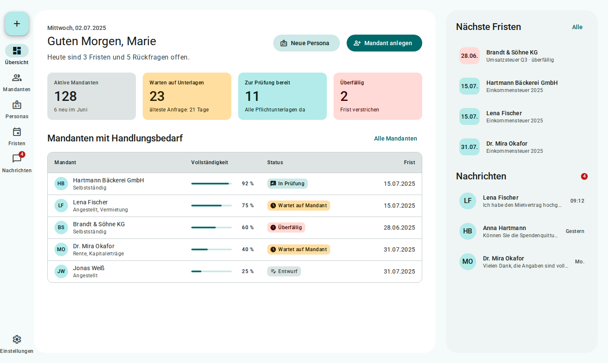

# Advisor home (Übersicht)

> Mockup, not part of the design system. Open [`mockup.html`](mockup.html) through a local server, or see the screenshots below. Sample data only.

The advisor home (**Übersicht**) answers one question: _what needs my attention today?_ It is a **detail pane plus supporting pane**; there is no list pane because nothing is selected yet.

**Structure:** navigation rail (Übersicht active) | **main pane** (greeting with a one-line summary, four KPI cards, a table of clients that need action) | **supporting pane** (next deadlines, latest messages).

- The greeting names the work, not the system: "Heute sind 3 Fristen und 5 Rückfragen offen."
- KPI cards are navigation: each opens the Mandanten list filtered by that state. Use `md-card--tertiary` for waiting on clients, `md-card--primary` for ready to review, and an `error-container` card only for overdue.
- The table is sorted by urgency: Überfällig first, then nearest Frist. Progress is a linear indicator with a text percentage; status is always a `StatusChip`. A row opens the client in the Mandanten layout.
- Deadlines show the date in a tonal tile; overdue ones use `error-container`. Show at most five; "Alle Fristen" opens the Fristen page.
- The only filled button is **Mandant anlegen**; **Neue Persona** is tonal.

**Implementation:** Custom Svelte layout (`DetailSupportLayout.svelte`). KPI cards are `Card.svelte` wrapped in links; the table is `DataTable.svelte`; progress is `<md-linear-progress>`; status is `StatusChip.svelte`.

## Screenshots

